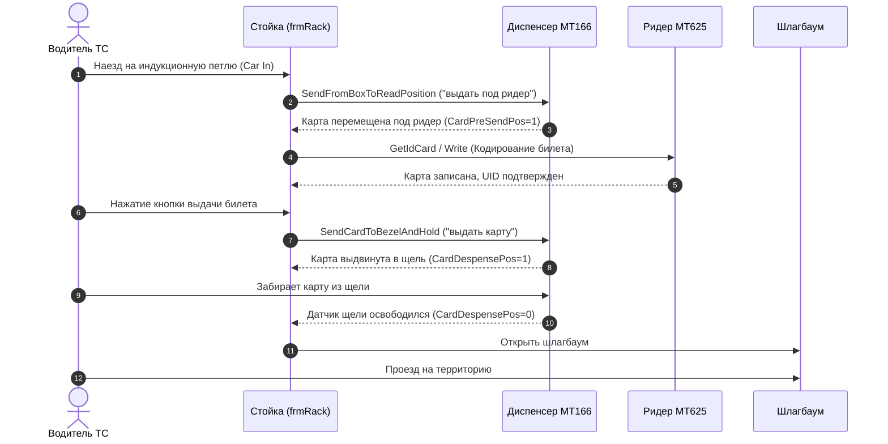

# Протокол обмена с диспенсером карт MT166 (Card Dispenser & Collector)

Данный документ содержит полное техническое описание протокола обмена по последовательному интерфейсу (RS-232 / UART) с моторизованным диспенсером карт **MT166** (и совместимыми моторизованными модулями выдачи и сбора карт), применяемым во въездных стойках парковок, терминалах выдачи карт и системах контроля доступа.

Описание составлено на основе анализа и декомпиляции рабочего драйвера `Communications.DispenserMT166` и модуля управления стойкой `stoyka01.exe` (`frmRack.cs`).

---

## 1. Параметры последовательного порта (COM-порт)

Связь с диспенсером осуществляется через интерфейс RS-232.

| Параметр | Значение | Описание |
| :--- | :--- | :--- |
| **Скорость (Baud Rate)** | `9600` | 9600 бод *(обратите внимание: в отличие от ридера MT625, у которого 115200, диспенсер работает на 9600)* |
| **Биты данных (Data Bits)** | `8` | 8 бит данных |
| **Четность (Parity)** | `None` | Без контроля четности |
| **Стоп-биты (Stop Bits)** | `1` | 1 стоп-бит |
| **Управление потоком (Handshake)** | `None` | Отключено |
| **Read Timeout** | `100`..`500 мс` | Таймаут ожидания байт ответа |
| **Write Timeout** | `100`..`500 мс` | Таймаут отправки команды |

> **Рекомендация по драйверу:** Перед каждой отправкой команды необходимо выполнять сброс буферов порта `DiscardInBuffer()` и `DiscardOutBuffer()`.

---

## 2. Формат пакетов (Фрейминг)

Все команды и ответы передаются в бинарно-символьном фрейме с контрольной суммой по алгоритму XOR (BCC).

### 2.1. Структура пакета запроса (Команда управляющего ПК)

Длина стандартной команды составляет 7 байт:

```
+------+--------+--------+----+----+------+-----+
| STX  | Len Hi | Len Lo | CW | CP | ETX  | BCC |
| 0x02 |  0x00  |  0x02  | 1B | 1B | 0x03 | 1B  |
+------+--------+--------+----+----+------+-----+
```

* **STX** (`0x02`) — байт начала пакета (Start of Text).
* **Length** (`0x00, 0x02`) — длина полезных данных команды (Big-Endian, всегда 2 байта: CW + CP).
* **CW** (Command Word) — символ команды (ASCII: `'0'`, `'1'`, `'2'`, `'3'`).
* **CP** (Command Parameter) — символ подкоманды / параметра (ASCII: `'0'`, `'1'`, `'2'`).
* **ETX** (`0x03`) — байт окончания команды (End of Text).
* **BCC** — 1 байт контрольной суммы (XOR всех байтов от `STX` до `ETX` включительно).

#### Расчет контрольной суммы (BCC):
Побайтовый XOR всех предшествующих байтов пакета (индексы 0..5):

$$\text{BCC} = \text{STX} \oplus \text{LenHi} \oplus \text{LenLo} \oplus \text{CW} \oplus \text{CP} \oplus \text{ETX}$$

Пример на C#:
```csharp
private string AddBCC(string req)
{
    byte[] bytes = Encoding.ASCII.GetBytes(req);
    byte bcc = 0;
    foreach (byte b in bytes)
    {
        bcc ^= b;
    }
    return req + (char)bcc;
}
```

---

### 2.2. Структура пакета ответа (Ответ диспенсера)

```
+------+--------+--------+---------+---------+-------------+-----------------+------+-----+
| STX  | Len Hi | Len Lo | CW Echo | CP Echo | Status Byte | Data (Optional) | ETX  | BCC |
| 0x02 |  (1B)  |  (1B)  |   1B    |   1B    |     1B      | (Length - 3) B  | 0x03 | 1B  |
+------+--------+--------+---------+---------+-------------+-----------------+------+-----+
```

* **STX** (`0x02`) — начало ответа.
* **Length** (`rx[1]`, `rx[2]`) — 2 байта длины данных ответа:  
  $$\text{Length} = (rx[1] \ll 8) + rx[2]$$  
  Полная длина пакета ответа: $\text{TotalRxSize} = \text{Length} + 5$.
* **CW Echo** (`rx[3]`) — эхо отправленного символа команды.
* **CP Echo** (`rx[4]`) — эхо отправленного параметра.
* **Status Byte / Sensor Mask** (`rx[5]`):
  * Для команд перемещения и версии: `'Y'` (`0x59`, 89 dec) — успех, `'N'` (`0x4E`, 78 dec) — ошибка.
  * Для команды статуса (`CW = '2'`): битовая маска датчиков наличия и положения карты.
* **Data** (`rx[6 ... Length+2]`) — опциональные данные (например, ASCII-строка версии прошивки).
* **ETX** (`0x03`) — байт завершения данных (находится по индексу `Length + 3`).
* **BCC** (`rx[Length + 4]`) — контрольная сумма XOR всех байтов с 0 по `Length + 3`.

#### Проверка контрольной суммы ответа:
```csharp
bool CheckBCC(byte[] rx, int rxSize)
{
    int length = (rx[1] << 8) + rx[2];
    byte bcc = 0;
    for (int i = 0; i < length + 4; i++)
    {
        bcc ^= rx[i];
    }
    return bcc == rx[length + 4];
}
```

---

## 3. Таблица команд диспенсера MT166

| Команда (C# метод) | CW | CP | Полный TX пакет (Hex) | Описание действия |
| :--- | :---: | :---: | :--- | :--- |
| **`GetVersion`** | `'0'` | `'0'` | `02 00 02 30 30 03 03` | Запрос строки версии прошивки диспенсера |
| **`GetStatus`** | `'2'` | `'0'` | `02 00 02 32 30 03 01` | Запрос состояния датчиков (наличие карт, замятия, позиция) |
| **`SendFromBoxToReadPosition`** | `'1'` | `'0'` | `02 00 02 31 30 03 02` | **Выдать под ридер:** подача 1 карты из магазина в позицию RF-кодирования |
| **`SendCardToBezelAndHold`** | `'1'` | `'1'` | `02 00 02 31 31 03 03` | **Выдать карту:** выдвинуть карту в выходную щель (губы) с удержанием |
| **`SendCardToBezelAndNotHold`**| `'1'` | `'2'` | `02 00 02 31 32 03 00` | **Выбросить карту:** вытолкнуть карту из щели наружу без удержания |
| **`SendFromBezelToReadPosition`**| `'3'` | `'2'` | `02 00 02 33 32 03 00` | **Втянуть карту:** захват карты из щели (губ) обратно в позицию чтения |
| **`SendCardToRecycleBox`** | `'3'` | `'0'` | `02 00 02 33 30 03 02` | **Сброс в отказник:** сбросить неисправную/невостребованную карту в ящик сбора |
| **`RecycleToReadPosition`** | `'3'` | `'1'` | `02 00 02 33 31 03 03` | Подача карты из отказника/накопителя в позицию чтения |

---

## 4. Детальное описание и ответы команд

### 4.1. `GetVersion` (`CW='0', CP='0'`) — Версия прошивки
* **Назначение:** Проверка связи с устройством и получение идентификатора ревизии прошивки.
* **Ответ при успехе (`rx[5] == 0x59` / `'Y'`):**
  * `rx[3] == 0x30` (`'0'`).
  * Символы строки версии содержатся в `rx[6 ... Length + 2]`. Длина строки равна `Length - 3`.
* **Ответ при ошибке (`rx[5] == 0x4E` / `'N'`):** устройство не может вернуть версию, статус устанавливается в `"Unknown"`.

---

### 4.2. `GetStatus` (`CW='2', CP='0'`) — Опрос датчиков диспенсера
Это ключевая команда регулярного мониторинга состояния диспенсера. Возвращает битовую маску оптических и механических датчиков тракта.

* **Байт маски датчиков находится в `rx[5]`:**

| Бит | Маска (Hex) | Поле структуры `DispensStatus` | Значение `1` (True) | Значение `0` (False) | Текстовый статус стойки |
| :---: | :---: | :--- | :--- | :--- | :--- |
| **Bit 0** | `0x01` | `CardTimeOut` | Превышен таймаут операции | Норма | — |
| **Bit 1** | `0x02` | `CardError` | **Замятие карты в тракте** | Тракт в норме | `карта застряла` |
| **Bit 2** | `0x04` | `CardAccepting` | Карта в процессе захвата/движения | В покое | — |
| **Bit 3** | `0x08` | `CardDispensing` | Карта в процессе выдачи/движения | В покое | — |
| **Bit 4** | `0x10` | `CardShortage` | **Мало карт в стеке** (Pre-empty) | Достаточно карт | `мало карт` |
| **Bit 5** | `0x20` | `CardPreSendPos` | **Карта находится под ридером** | Под ридером пусто | `карта под ридером` |
| **Bit 6** | `0x40` | `CardDespensePos`| **Карта находится в выходной щели (в губах)** | В губах карты нет | `карта в губах` |
| **Bit 7** | `0x80` | `CardEmpty` | **Стек карт пуст** | Карты есть | `нет карт` |

#### Логика вычисления обобщенных статусов в ПО:
* Если `CardError == true` $\rightarrow$ статус: **`"карта застряла"`** (авария диспенсера, стойка блокирует въезд).
* Если `CardDespensePos == true` $\rightarrow$ статус: **`"карта в губах"`** (ожидание, пока водитель вытащит карту).
* Если `CardPreSendPos == true` $\rightarrow$ статус: **`"карта под ридером"`** (готова к записи тарифа/чтению UID ридером MT625).
* Если `CardEmpty == true` $\rightarrow$ статус: **`"нет карт"`** (требуется пополнение магазина карт оператором).
* Если `CardShortage == true` $\rightarrow$ статус: **`"мало карт"`** (предупредительный аларм для обслуживающего персонала).
* Если движения нет и ни под ридером, ни в щели карт нет $\rightarrow$ статус: **`"нет карты в тракте"`** (готов к приему новой команды).

---

### 4.3. `SendFromBoxToReadPosition` (`CW='1', CP='0'`) — Выдача под ридер
* **Назначение:** Мотор диспенсера захватывает нижнюю карту из стопки магазина (картоприемника), протягивает ее по тракту и останавливает точно над встроенной RF-антенной.
* **Результат:** Датчик `CardPreSendPos` (Bit 5) становится равным `1`.
* После этого стойка передает управление ридеру MT625 для кодирования данных билета / парковочной сессии.

---

### 4.4. `SendCardToBezelAndHold` (`CW='1', CP='1'`) — Выдача в губы с удержанием
* **Назначение:** После успешной записи данных на карту мотор проталкивает ее вперед в щель выдачи (bezel).
* **Поведение:** Диспенсер удерживает карту роликами за хвостовую часть так, чтобы водитель мог комфортно взяться за нее рукой, но карта не выпадала на дорогу под колеса.
* **Результат:** Датчик `CardDespensePos` (Bit 6) равен `1`. Когда водитель тянет карту на себя, датчик сбрасывается в `0`.

---

### 4.5. `SendCardToBezelAndNotHold` (`CW='1', CP='2'`) — Выброс карты
* **Назначение:** Полный выталкивающий импульс, при котором карта полностью вылетает из щели наружу (применяется в некоторых типах накопителей).

---

### 4.6. `SendCardToRecycleBox` (`CW='3', CP='0'`) — Сброс в отказник (Recycle)
* **Назначение:** Принудительный сброс карты в нижний внутренний ящик отбраковки/сбора.
* **Случаи применения:**
  1. Если при кодировании карты ридер MT625 вернул ошибку записи / "чужая карта" / нечитаемый чип.
  2. Если карта была выдана в губы, но водитель в течение установленного времени (таймаут 30..60 сек) не забрал ее. Чтобы чужой человек не забрал активный билет, стойка втягивает карту и сбрасывает в отказник.

---

### 4.7. `SendFromBezelToReadPosition` (`CW='3', CP='2'`) — Втягивание из щели
* **Назначение:** Реверсивный ход мотора. Захватывает карту из щели (если она еще не вынута) и протягивает ее назад в зону чтения.

---

## 5. Типовой сценарий работы въездной стойки



### Сценарий обработки сбоя (Отказник):
1. Если на шаге 3 ридер не смог прочитать или записать карту (битый Mifare чип):
   * Стойка не выдает карту клиенту.
   * Отправляется команда: `SendCardToRecycleBox` (`02 00 02 33 30 03 02`).
   * Карта сбрасывается в ящик брака.
   * Стойка автоматически делает вторую попытку: берет следующую карту из магазина `SendFromBoxToReadPosition`.

---

## 6. Машина состояний диспенсера в коде `frmRack.cs`

Опрос и управление диспенсером выполняются в основном таймере формы через машину состояний `etapDispens`:

* **`etapDispens = 0`:** Ожидание постановки команды в очередь (`GlobalClass.comDispens`). Если команда появилась $\rightarrow$ переход в `1`.
* **`etapDispens = 1`:** Инициализация и открытие порта:
  ```csharp
  if (Dispens.Open("COM" + portNumber)) etapDispens = 2;
  else { etapDispens = 0; labelComDispens.Text = "не отвечает #1"; }
  ```
* **`etapDispens = 2`:** Непосредственная отправка команды:
  * В зависимости от `GlobalClass._comDispens` вызывается нужный метод (`GetStatus`, `SendFromBoxToReadPosition`, `SendCardToBezelAndHold` и т.д.).
  * Устанавливается программный таймаут: `GlobalClass.timer_dispens = 40` (около 4 секунд) либо `5` (для быстрых опросов).
  * Переход в состояние ожидания ответа: `etapDispens = 3`.
* **`etapDispens = 3`:** Ожидание завершения операции (`Dispens.Wait1()`):
  * Если `timer_dispens == 0` (таймаут ответа устройства) $\rightarrow$ ошибка `«не отвечает #3»`, переход в `etapDispens = 5` для аварийного закрытия порта.
  * Если получен валидный ответ с совпадением BCC $\rightarrow$ разбор битовой маски `Dispens.CardDispenserStatus`, обновление текста в UI (`"карта в губах"`, `"карта под ридером"`, `"нет карт"`), переход в `etapDispens = 2` (готов к следующей команде).
* **`etapDispens = 5`:** Аварийное закрытие порта при зависании:
  * Вызов `Dispens.Close()`, сброс в `etapDispens = 0` для последующего чистого переподключения.

---

## 7. Рекомендации по интеграции и устранению неполадок

1. **Не путать скорости портов:**  
   Диспенсер MT166 работает на скорости **9600 бод**, в то время как RFID-ридер MT625 на этой же стойке работает на скорости **115200 бод**.
2. **Таймауты механических перемещений:**  
   Физическое перемещение карты мотором занимает от 0.5 до 2.5 секунд. При реализации управляющего драйвера таймаут ожидания завершения для команд `10`, `11`, `30` должен составлять не менее 3–5 секунд.
3. **Регулярный опрос статуса (`Polling`):**  
   Для своевременного обнаружения извлечения карты посетителем из щели необходимо циклически вызывать `GetStatus()` с интервалом `100`..`200 мс`.
4. **Аварийные состояния датчиков:**  
   * Если одновременно взведены `CardEmpty` и `CardShortage` — магазин полностью пуст, прием денег / нажатие кнопки въезда должно блокироваться интерфейсом стойки.
   * Если взведен `CardError` — произошло механическое замятие, дальнейшие команды подачи мотора должны быть заблокированы до ручного извлечения карты оператором.
