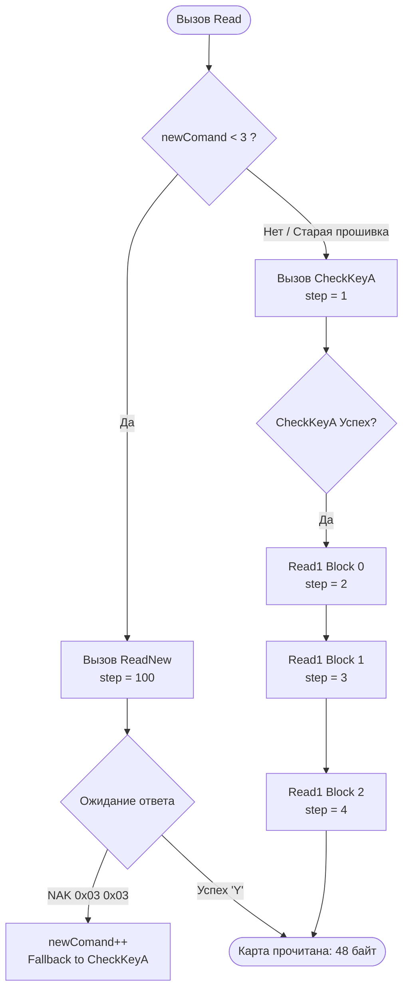

# Протокол обмена со считывателем карт MT625 (RFID Mifare)

Данный документ содержит полное техническое описание протокола обмена по последовательному интерфейсу (RS-232 / UART) со считывателем бесконтактных карт **MT625** (Mifare Classic 1K / 4K / Ultralight), используемым в стойках автоматизации парковок и контроля доступа.

Описание составлено на основе реверс-инжиниринга и декомпиляции рабочего драйвера `Communications.MT625Reader` и модуля `stoyka01.exe` (`frmRack.cs`).

---

## 1. Параметры последовательного порта (COM-порт)

Связь с ридером осуществляется через стандартный COM-порт (распаянный на плате либо через USB-RS232 преобразователь).

| Параметр | Значение | Описание |
| :--- | :--- | :--- |
| **Скорость (Baud Rate)** | `115200` | 115200 бод |
| **Биты данных (Data Bits)** | `8` | 8 бит |
| **Четность (Parity)** | `None` | Без контроля четности |
| **Стоп-биты (Stop Bits)** | `1` | 1 стоп-бит |
| **Управление потоком (Handshake)** | `None` | Аппаратное/программное управление отключено |
| **Read Timeout** | `200`..`500 мс` | Таймаут ожидания ответа |
| **Write Timeout** | `200`..`500 мс` | Таймаут отправки команды |

> **Важно при реализации драйвера:** Перед отправкой каждой команды необходимо очищать входной и выходной буферы порта (`DiscardInBuffer()`, `DiscardOutBuffer()`). При потере связи с ридером обязательно выполнять физический `Close()` с паузой `100 мс` перед повторным `Open()`.

---

## 2. Структура пакета (Фрейминг)

Все сообщения передаются в бинарном виде в обрамлении стартового и стопового байтов с контрольной суммой BCC (XOR).

### 2.1. Формат пакета запроса (TX)

```
+------+--------+--------+------------+------------+-----------------+------+-----+
| STX  | Len Hi | Len Lo | Cmd Group  |   Opcode   | Data / Payload  | ETX  | BCC |
| 0x02 | (1 B)  | (1 B)  | 1 Byte     | 1 Byte     | (Len - 2) Bytes | 0x03 | 1 B |
+------+--------+--------+------------+------------+-----------------+------+-----+
```

* **STX** (`0x02`) — байт начала пакета (Start of Text).
* **Length** (`tx[1]`, `tx[2]`) — длина полезной нагрузки пакета (2 байта, **Big-Endian**):  
  $$\text{Length} = (tx[1] \ll 8) + tx[2]$$  
  Длина включает: `Cmd Group` + `Opcode` + `Data`.  
  Полный размер отправляемого массива байт:  
  $$\text{TotalSize} = \text{Length} + 5$$  
  (учитывает STX, 2 байта длины, ETX, BCC).
* **Cmd Group** (`tx[3]`) — группа команд в ASCII:
  * `'1'` (`0x31`, 49 dec) — системные команды (версия и т.д.).
  * `'4'` (`0x34`, 52 dec) — команды работы с картами Mifare.
* **Opcode** (`tx[4]`) — код операции (ASCII-символ):
  * `'@'` (`0x40`) — запрос версии прошивки.
  * `'0'` (`0x30`) — поиск/опрос наличия карты в поле.
  * `'1'` (`0x31`) — чтение UID карты.
  * `'2'` (`0x32`) — авторизация сектора по ключу KeyA.
  * `'9'` (`0x39`) — авторизация сектора по ключу KeyB.
  * `'3'` (`0x33`) — чтение одного 16-байтного блока.
  * `'4'` (`0x34`) — запись одного 16-байтного блока.
  * `'5'` (`0x35`) — смена ключей/хвостовика сектора (WriteKey).
  * `':'` (`0x3A`, 58 dec) — пакетное чтение всех 3 блоков сектора (ReadNew).
  * `';'` (`0x3B`, 59 dec) — пакетная запись всех 3 блоков сектора (WriteNew).
* **Data / Payload** (`tx[5 ... TotalSize-3]`) — параметры команды (номер сектора, блока, ключи, данные).
* **ETX** (`0x03`) — байт окончания полезной нагрузки (End of Text). Расположен по смещению `TotalSize - 2`.
* **BCC** — 1 байт контрольной суммы (Block Check Character). Расположен в самом конце (`TotalSize - 1`).

#### Алгоритм расчета контрольной суммы BCC:
Побайтовый XOR всех байтов пакета, начиная от `STX` (`index 0`) до `ETX` (`index TotalSize - 2`) включительно:

$$\text{BCC} = \bigoplus_{i=0}^{\text{TotalSize}-2} tx[i]$$

В коде C#:
```csharp
txSize = (tx[1] << 8) + tx[2] + 5;
tx[0] = 0x02; // STX
tx[txSize - 2] = 0x03; // ETX
tx[txSize - 1] = 0; // очистка байта BCC

for (int i = 0; i < txSize - 1; i++)
{
    tx[txSize - 1] ^= tx[i];
}
```

---

### 2.2. Формат пакета ответа (RX)

```
+------+--------+--------+------------+------------+-------------+-----------------+------+-----+
| STX  | Len Hi | Len Lo | Cmd Echo   | Opcode     | Status Byte | Payload / Data  | ETX  | BCC |
| 0x02 | (1 B)  | (1 B)  | 1 Byte     | 1 Byte     | 1 Byte      | (Len - 3) Bytes | 0x03 | 1 B |
+------+--------+--------+------------+------------+-------------+-----------------+------+-----+
```

* **STX** (`0x02`) — начало ответа.
* **Length** (`rx[1]`, `rx[2]`) — длина полезных данных ответа:  
  $$\text{Length} = (rx[1] \ll 8) + rx[2]$$
* **Cmd Echo / Opcode** (`rx[3]`, `rx[4]`) — эхо отправленной группы и кода команды.
* **Status Byte**:
  * В большинстве команд статус успеха возвращается в байте `rx[5]` или `rx[6]` / `rx[7]` (см. описание конкретных команд ниже).
  * **`0x59` (`'Y'` / ASCII 89 dec)** — Успех (Yes / OK).
  * **`0x4E` (`'N'` / ASCII 78 dec)** или любое другое значение — Ошибка / Отказ.
* **Special NAK (Неподдерживаемая команда):**  
  Если ридер вернул 2 байта `[0x03, 0x03]`, это означает, что данная версия прошивки не поддерживает запрошенную команду (например, пакетные команды `0x3A` или `0x3B`).

#### Проверка целостности ответа (CheckBCC):
Ответ считается валидным, если длина `rxSize >= Length + 5` и контрольная сумма совпадает:
```csharp
bool CheckBCC(byte[] rx, int rxSize)
{
    int length = (rx[1] << 8) + rx[2];
    byte bcc = 0;
    for (int i = 0; i < length + 4; i++)
    {
        bcc ^= rx[i];
    }
    return bcc == rx[length + 4];
}
```

---

## 3. Детальное описание команд

### 3.1. `GetVersion` — Запрос версии прошивки ридера

* **Группа:** `'1'` (`0x31`), **Opcode:** `'@'` (`0x40`)
* **Длина полезной нагрузки (Length):** `2` (`0x00, 0x02`)
* **Полный TX пакет (7 байт):**
  ```hex
  02 00 02 31 40 03 70
  ```
* **Ответ ридера:**
  * `rx[4] == 0x40` (`'@'`)
  * `rx[5...]` — строка/байты версии устройства. В базовом драйвере статус устанавливается в `"неопределен"`.

---

### 3.2. `GetCard` — Проверка наличия карты в поле

* **Группа:** `'4'` (`0x34`), **Opcode:** `'0'` (`0x30`)
* **Длина полезной нагрузки (Length):** `2` (`0x00, 0x02`)
* **Полный TX пакет (7 байт):**
  ```hex
  02 00 02 34 30 03 05
  ```
* **Ответ ридера:**
  * `rx[4] == 0x30` (`'0'`)
  * `rx[5] == 0x59` (`'Y'`) $\rightarrow$ Статус: **`"есть карта"`** (карта поднесена к считывателю).
  * `rx[5] != 0x59` $\rightarrow$ Статус: **`"нет карты"`** (поле считывателя пусто).

---

### 3.3. `GetIdCard` — Чтение идентификатора (UID) карты

* **Группа:** `'4'` (`0x34`), **Opcode:** `'1'` (`0x31`)
* **Длина полезной нагрузки (Length):** `2` (`0x00, 0x02`)
* **Полный TX пакет (7 байт):**
  ```hex
  02 00 02 34 31 03 04
  ```
* **Ответ ридера:**
  * `rx[4] == 0x31` (`'1'`)
  * `rx[5] == 0x59` (`'Y'`) $\rightarrow$ Статус: **`"есть ID"`**:
    * Длина UID в байтах: `cardIdL = rx[2] - 3` (обычно 4 байта для Mifare Classic 1K, либо 7 байт для Mifare Plus / Ultralight).
    * Байты UID располагаются, начиная со смещения `rx[6]`.
    * В драйвере они выравниваются по правому краю 8-байтового массива `cardIdCard[8]`:
      ```csharp
      int cardIdL = rx[2] - 3;
      byte[] cardIdCard = new byte[8];
      for (int m = 0; m < cardIdL; m++)
      {
          int num = m + 8 - cardIdL;
          cardIdCard[num] = rx[m + 6];
      }
      ```
  * `rx[5] != 0x59` $\rightarrow$ Статус: **`"нет ID"`**.

> **Преобразование UID в число (Wiegand/Decimal):**  
> В `stoyka01.exe` массив `cardIdCard` при флаге `CardidReverseDec = true` разворачивается побайтово (Little $\leftrightarrow$ Big Endian), форматируется в Hex-строку и преобразуется в `long.Parse(hex, NumberStyles.HexNumber)`.

---

### 3.4. `CheckKeyA` — Авторизация сектора по ключу KeyA

Проверяет доступ к указанному сектору Mifare Classic с использованием 6-байтного ключа KeyA.

* **Группа:** `'4'` (`0x34`), **Opcode:** `'2'` (`0x32`)
* **Длина полезной нагрузки (Length):** `9` (`0x00, 0x09`)
* **Формат TX пакета (14 байт):**
  ```
  [0x02] [0x00 0x09] [0x34] [0x32] [Sector] [KeyA_0 .. KeyA_5] [0x03] [BCC]
  ```
  * `tx[5]` — номер сектора Mifare (`0`..`15` для Mifare 1K).
  * `tx[6..11]` — 6 байт ключа KeyA (по умолчанию на чистых картах `FF FF FF FF FF FF`).
* **Ответ ридера:**
  * `rx[4] == 0x32` (`'2'`)
  * `rx[6] == 0x59` (`'Y'`) $\rightarrow$ Статус: **`"есть карта"`** (авторизация успешна, доступ к сектору разрешен).
  * `rx[6] != 0x59` $\rightarrow$ Статус: **`"чужая карта"`** (неверный ключ доступа / ошибка авторизации).

---

### 3.5. `CheckKeyB` — Авторизация сектора по ключу KeyB

Аналогична `CheckKeyA`, но использует второй ключ сектора (KeyB).

* **Группа:** `'4'` (`0x34`), **Opcode:** `'9'` (`0x39`)
* **Длина полезной нагрузки (Length):** `9` (`0x00, 0x09`)
* **Формат TX пакета (14 байт):**
  ```
  [0x02] [0x00 0x09] [0x34] [0x39] [Sector] [KeyB_0 .. KeyB_5] [0x03] [BCC]
  ```
* **Ответ ридера:**
  * `rx[4] == 0x39` (`'9'`)
  * `rx[6] == 0x59` (`'Y'`) $\rightarrow$ Статус: **`"есть карта"`** (успех).
  * `rx[6] != 0x59` $\rightarrow$ Статус: **`"чужая карта"`** (ошибка).

---

### 3.6. `Read1` — Чтение одного блока (16 байт)

Читает 16 байт данных из одного конкретного блока сектора (предварительно должна быть выполнена успешная авторизация `CheckKeyA` или `CheckKeyB` для этого сектора!).

* **Группа:** `'4'` (`0x34`), **Opcode:** `'3'` (`0x33`)
* **Длина полезной нагрузки (Length):** `4` (`0x00, 0x04`)
* **Формат TX пакета (9 байт):**
  ```
  [0x02] [0x00 0x04] [0x34] [0x33] [Sector] [Block] [0x03] [BCC]
  ```
  * `tx[5]` — номер сектора (`0`..`15`).
  * `tx[6]` — относительный номер блока внутри сектора:
    * `0` — Блок 0 сектора.
    * `1` — Блок 1 сектора.
    * `2` — Блок 2 сектора.
    *(Блок 3 является секторным трейлером и содержит ключи/биты доступа).*
* **Ответ ридера:**
  * `rx[4] == 0x33` (`'3'`)
  * `rx[7] == 0x59` (`'Y'`) $\rightarrow$ Статус: **`"карта прочитана"`**:
    * 16 байт данных блока находятся со смещения `rx[8]` по `rx[23]`.
  * `rx[7] != 0x59` $\rightarrow$ Статус: **`"ошибка чтения"`**.

---

### 3.7. `Write1` — Запись одного блока (16 байт)

Записывает 16 байт данных в указанный блок сектора (предварительно авторизованного).

* **Группа:** `'4'` (`0x34`), **Opcode:** `'4'` (`0x34`)
* **Длина полезной нагрузки (Length):** `20` (`0x00, 0x14`)
* **Формат TX пакета (25 байт):**
  ```
  [0x02] [0x00 0x14] [0x34] [0x34] [Sector] [Block] [Data 16 Bytes] [0x03] [BCC]
  ```
  * `tx[5]` — номер сектора.
  * `tx[6]` — относительный номер блока (`0`, `1` или `2`).
  * `tx[7..22]` — 16 байт данных для записи.
* **Ответ ридера:**
  * `rx[4] == 0x34` (`'4'`)
  * `rx[7] == 0x59` (`'Y'`) $\rightarrow$ Статус: **`"карта записана"`**.
  * `rx[7] != 0x59` $\rightarrow$ Статус: **`"ошибка записи"`**.

---

### 3.8. `ReadNew` — Быстрое пакетное чтение всех 3 блоков сектора (48 байт)

Выполняет авторизацию и считывает сразу все три блока пользовательских данных сектора (Блок 0, Блок 1, Блок 2 = 48 байт суммарно) за **один** запрос.

* **Группа:** `'4'` (`0x34`), **Opcode:** `':'` (`0x3A`, 58 dec)
* **Длина полезной нагрузки (Length):** `10` (`0x00, 0x0A`)
* **Формат TX пакета (15 байт):**
  ```
  [0x02] [0x00 0x0A] [0x34] [0x3A] [Sector] [0x00] [KeyA 6 Bytes] [0x03] [BCC]
  ```
  * `tx[5]` — номер сектора.
  * `tx[6]` — `0x00` (флаг/резерв).
  * `tx[7..12]` — 6 байт ключа KeyA.
* **Ответ ридера:**
  * `rx[4] == 0x3A` (`':'`)
  * `rx[5] == 0x59` (`'Y'`) $\rightarrow$ Статус: **`"карта прочитана"`**:
    * **Блок 0 (16 байт):** с `rx[6]` по `rx[21]`.
    * *(байт-разделитель в `rx[22]`)*
    * **Блок 1 (16 байт):** с `rx[23]` по `rx[38]`.
    * *(байт-разделитель в `rx[39]`)*
    * **Блок 2 (16 байт):** с `rx[40]` по `rx[55]`.
  * `rx[5] != 0x59` $\rightarrow$ Статус: **`"ошибка чтения"`**.

---

### 3.9. `WriteNew` — Быстрая пакетная запись всех 3 блоков сектора (48 байт)

Выполняет авторизацию и записывает все три блока данных сектора за **один** запрос.

* **Группа:** `'4'` (`0x34`), **Opcode:** `';'` (`0x3B`, 59 dec)
* **Длина полезной нагрузки (Length):** `60` (`0x00, 0x3C`)
* **Формат TX пакета (65 байт):**
  ```
  [0x02] [0x00 0x3C] [0x34] [0x3B] [Sector] [0x00] [KeyA 6B] [Block0 16B] [0x3B] [Block1 16B] [0x3B] [Block2 16B] [0x03] [BCC]
  ```
  * `tx[5]` — номер сектора.
  * `tx[6]` — `0x00`.
  * `tx[7..12]` — 6 байт ключа KeyA.
  * `tx[13..28]` — 16 байт данных Блока 0.
  * `tx[29]` — разделитель `0x3B` (`';'`).
  * `tx[30..45]` — 16 байт данных Блока 1.
  * `tx[46]` — разделитель `0x3B` (`';'`).
  * `tx[47..62]` — 16 байт данных Блока 2.
* **Ответ ридера:**
  * `rx[4] == 0x3B` (`';'`)
  * `rx[5] == 0x59` (`'Y'`) $\rightarrow$ Статус: **`"карта записана"`**.
  * `rx[5] != 0x59` $\rightarrow$ Статус: **`"ошибка записи"`**.

---

### 3.10. `WriteKey` — Запись нового ключа KeyA в сектор

* **Группа:** `'4'` (`0x34`), **Opcode:** `'5'` (`0x35`)
* **Длина полезной нагрузки (Length):** `9` (`0x00, 0x09`)
* **Формат TX пакета (14 байт):**
  ```
  [0x02] [0x00 0x09] [0x34] [0x35] [Sector] [NewKeyA 6 Bytes] [0x03] [BCC]
  ```
  * `tx[5]` — номер сектора.
  * `tx[6..11]` — 6 байт нового ключа KeyA.
* **Ответ ридера:**
  * `rx[4] == 0x35` (`'5'`)
  * `rx[6] == 0x59` (`'Y'`) $\rightarrow$ Статус: **`"WriteKeyOk"`**.
  * `rx[6] != 0x59` $\rightarrow$ Статус: **`"чужая карта"`**.

---

## 4. Высокоуровневые автоматы (State Machines) чтения и записи

В классе `Communications.MT625Reader` реализована встроенная многошаговая логика:

### 4.1. Автоматический выбор режима чтения (`Read()`):


1. **Оптимистичный быстрый режим (`ReadNew()`):**  
   Драйвер пробует прочитать сразу весь сектор за один запрос (`step = 100`).
2. **Адаптивный fallback на старые версии ридеров:**  
   Если ридер возвращает NAK (`rx[0]==3 && rx[1]==3`), счетчик `newComand` увеличивается. После 3 отказов драйвер навсегда переключается на классический пошаговый режим:
   * **Шаг 1 (`step = 1`):** Авторизация `CheckKeyA()`.
   * **Шаг 2 (`step = 2`):** Чтение `Read1(Block 0)`.
   * **Шаг 3 (`step = 3`):** Чтение `Read1(Block 1)`.
   * **Шаг 4 (`step = 4`):** Чтение `Read1(Block 2)`.

### 4.2. Автоматический выбор режима записи (`Write()`):
Аналогично чтению:
* Если `newComand < 3` $\rightarrow$ попытка быстрой пакетной записи `WriteNew()` (`step = 200`).
* При отказе/устаревшей прошивке $\rightarrow$ классический пошаговый цикл: `CheckKeyA()` (`step = 11`) $\rightarrow$ `Write1(0)` (`step = 12`) $\rightarrow$ `Write1(1)` (`step = 13`) $\rightarrow$ `Write1(2)` (`step = 14`).

---

## 5. Типовой цикл опроса в стойке (`frmRack.obmen()`)

Стойка опрашивает ридер по таймеру (каждые 100..200 мс) по следующей схеме:

1. **`etapOut = 1`:** Открытие порта (`OutReader.Open("COM4")`).
2. **`etapOut = 2`:** Отправка команды опроса карты:
   * Отправляется команда `OutReader.GetCard()`.
   * Устанавливается программный сторожевой таймер: `timer_riderOut = 10` (примерно 1..2 секунды).
   * Переход в `etapOut = 3`.
3. **`etapOut = 3`:** Ожидание завершения операции (`OutReader.Wait()`):
   * Если `timer_riderOut == 0` (таймаут ответа): переход в ошибку `«не отвечает #3»`, сброс `etapOut = 0`.
   * Если получен ответ `"есть карта"`: отправляется команда чтения ID (`GetIdCard()`) либо данных (`Read()`).
   * Если карта считана: извлекается UID и данные билетов, стойка открывает шлагбаум/проверяет базу данных.
4. **`etapOut = 4`:** Завершение обработки карты, возврат к опросу `GetCard()`.

---

## 6. Известные особенности и рекомендации для стабильной работы

1. **Необходимость физического Reopen:**  
   Если считыватель завис или отключился по питанию, вызов `Open()` при условии `if (!_serialPort.IsOpen)` не восстанавливает связь. Необходимо обязательно вызывать:
   ```csharp
   _serialPort.Close();
   Thread.Sleep(100);
   _serialPort.Open();
   _serialPort.DiscardInBuffer();
   _serialPort.DiscardOutBuffer();
   ```
2. **Асинхронность / Таймауты записи:**  
   Синхронный `SerialPort.Write` в WPF/WinForms приложениях может блокировать интерфейсный поток при подвисании драйвера. Рекомендуется запускать цикл обмена в фоновом потоке (`Task` / `BackgroundWorker`) и выставлять `WriteTimeout = 500`.
3. **Счетчик зависших запросов (Watchdog):**  
   Если подряд отправлено 3 команды без ответа (статус ридера остается `"ожидание"`), перед 4-й отправкой следует автоматически выполнить переоткрытие порта.
